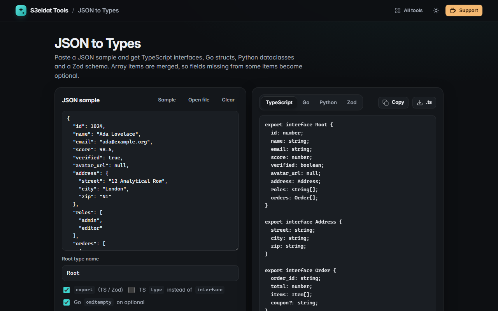

# JSON to Types

> Generate TypeScript, Go, Python and Zod types from a JSON sample. Free, private, and it runs entirely in your browser.

### ▶ [Open JSON to Types](https://s3eidat.github.io/json-to-types/)



## Features

- **TypeScript** interfaces (or `type` aliases), with `?` for optional and `| null` for nullable fields
- **Go** structs with `json:"…"` tags, Go-style names (`AvatarURL`, `UserID`), pointers for optional/nullable
  values and optional `omitempty`, aligned like `gofmt`
- **Python** `@dataclass` classes with `typing` hints; optional fields default to `None` and come last;
  renamed keys (`first-name` → `first_name`) are noted in a comment
- **Zod** schemas plus `z.infer` types, dependencies declared first
- **Merges array items**: a field missing from some items becomes optional, `null` makes it nullable,
  ints and floats merge to a float, mixed values become a union
- Nested objects get their own named types (`orders` → `Order`); identical shapes share one type
- Choose the **root type name**; copy or download each language

## Privacy

Your JSON never leaves your device. There is no server, no account, no analytics.
The page ships with a strict Content-Security-Policy (`connect-src 'self'`), so the browser
itself blocks any attempt to send data anywhere.

## Run it yourself

It's plain HTML, CSS and JavaScript with no build step:

```bash
git clone https://github.com/s3eidat/json-to-types
cd json-to-types
python -m http.server 8000
```

Then open http://localhost:8000.

## Support

If this saved you time, **[buy me a coffee ☕](https://s3eidat.github.io/coffee/)**. It keeps every tool free.

---

Part of **[S3eidat Tools](https://s3eidat.github.io/)**: 100+ free, private tools that run in your browser. MIT licensed.
